<!-- Assets in /assets are generated by scripts/build_profile.py and refreshed daily by .github/workflows/profile.yml -->

<picture><source media="(prefers-color-scheme: dark)" srcset="assets/hero-dark.svg" /><source media="(prefers-color-scheme: light)" srcset="assets/hero-light.svg" /></picture>

 

<a href="https://vshwk.vercel.app"><picture><source media="(prefers-color-scheme: dark)" srcset="assets/btn-portfolio-dark.svg" /><source media="(prefers-color-scheme: light)" srcset="assets/btn-portfolio-light.svg" /></picture></a>
<a href="https://www.linkedin.com/in/vishwas-k217/"><picture><source media="(prefers-color-scheme: dark)" srcset="assets/btn-linkedin-dark.svg" /><source media="(prefers-color-scheme: light)" srcset="assets/btn-linkedin-light.svg" /></picture></a>
<a href="https://drive.google.com/file/d/1rEMHNkw6TY7daXSVrY0SwTU7hoBowwBR/view?usp=drive_link"><picture><source media="(prefers-color-scheme: dark)" srcset="assets/btn-resume-dark.svg" /><source media="(prefers-color-scheme: light)" srcset="assets/btn-resume-light.svg" /></picture></a>
<a href="mailto:vishwasvishu2830@gmail.com"><picture><source media="(prefers-color-scheme: dark)" srcset="assets/btn-email-dark.svg" /><source media="(prefers-color-scheme: light)" srcset="assets/btn-email-light.svg" /></picture></a>

 

<picture><source media="(prefers-color-scheme: dark)" srcset="assets/h-about-dark.svg" /><source media="(prefers-color-scheme: light)" srcset="assets/h-about-light.svg" /></picture>
<picture><source media="(prefers-color-scheme: dark)" srcset="assets/about-dark.svg" /><source media="(prefers-color-scheme: light)" srcset="assets/about-light.svg" /></picture>

  

<picture><source media="(prefers-color-scheme: dark)" srcset="assets/h-featured-dark.svg" /><source media="(prefers-color-scheme: light)" srcset="assets/h-featured-light.svg" /></picture>

  <a href="https://github.com/Vishwas721/Glacies"><picture><source media="(prefers-color-scheme: dark)" srcset="assets/card-glacies-dark.svg" /><source media="(prefers-color-scheme: light)" srcset="assets/card-glacies-light.svg" /></picture></a>
  <a href="https://github.com/Vishwas721/SummAID"><picture><source media="(prefers-color-scheme: dark)" srcset="assets/card-summaid-dark.svg" /><source media="(prefers-color-scheme: light)" srcset="assets/card-summaid-light.svg" /></picture></a>
  <a href="https://github.com/Vishwas721/Privex"><picture><source media="(prefers-color-scheme: dark)" srcset="assets/card-privex-dark.svg" /><source media="(prefers-color-scheme: light)" srcset="assets/card-privex-light.svg" /></picture></a>
  <a href="https://github.com/Vishwas721/Carbon-Credit-Marketplace"><picture><source media="(prefers-color-scheme: dark)" srcset="assets/card-carbon-dark.svg" /><source media="(prefers-color-scheme: light)" srcset="assets/card-carbon-light.svg" /></picture></a>
  <a href="https://github.com/Vishwas721/Preuve"><picture><source media="(prefers-color-scheme: dark)" srcset="assets/card-preuve-dark.svg" /><source media="(prefers-color-scheme: light)" srcset="assets/card-preuve-light.svg" /></picture></a>
  <a href="https://github.com/Vishwas721/Panenka"><picture><source media="(prefers-color-scheme: dark)" srcset="assets/card-panenka-dark.svg" /><source media="(prefers-color-scheme: light)" srcset="assets/card-panenka-light.svg" /></picture></a>
  <a href="https://klados.vercel.app"><picture><source media="(prefers-color-scheme: dark)" srcset="assets/card-klados-dark.svg" /><source media="(prefers-color-scheme: light)" srcset="assets/card-klados-light.svg" /></picture></a>
  <a href="https://nagarikone.vercel.app"><picture><source media="(prefers-color-scheme: dark)" srcset="assets/card-nagarikone-dark.svg" /><source media="(prefers-color-scheme: light)" srcset="assets/card-nagarikone-light.svg" /></picture></a>

 

<picture><source media="(prefers-color-scheme: dark)" srcset="assets/h-toolbox-dark.svg" /><source media="(prefers-color-scheme: light)" srcset="assets/h-toolbox-light.svg" /></picture>
<picture><source media="(prefers-color-scheme: dark)" srcset="assets/toolbox-dark.svg" /><source media="(prefers-color-scheme: light)" srcset="assets/toolbox-light.svg" /></picture>

  

<picture><source media="(prefers-color-scheme: dark)" srcset="assets/h-activity-dark.svg" /><source media="(prefers-color-scheme: light)" srcset="assets/h-activity-light.svg" /></picture>
<picture><source media="(prefers-color-scheme: dark)" srcset="assets/stats-dark.svg" /><source media="(prefers-color-scheme: light)" srcset="assets/stats-light.svg" /></picture>

  

<picture><source media="(prefers-color-scheme: dark)" srcset="assets/feed-dark.svg" /><source media="(prefers-color-scheme: light)" srcset="assets/feed-light.svg" /></picture>

  

<picture>
  <source media="(prefers-color-scheme: dark)" srcset="profile-3d-contrib/profile-night-rainbow.svg" />
  <source media="(prefers-color-scheme: light)" srcset="profile-3d-contrib/profile-season-animate.svg" />
  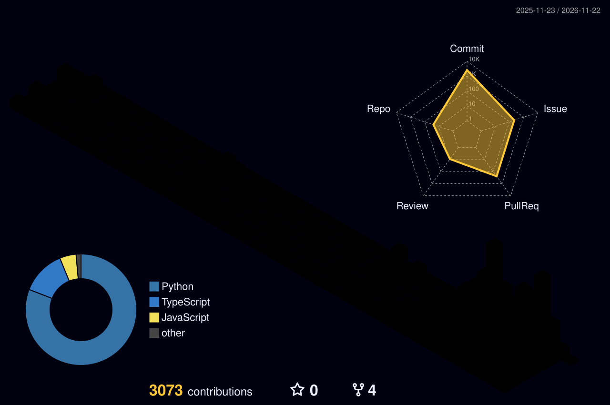
</picture>

<picture>
  <source media="(prefers-color-scheme: dark)" srcset="https://raw.githubusercontent.com/Vishwas721/Vishwas721/output/snake-dark.svg" />
  <source media="(prefers-color-scheme: light)" srcset="https://raw.githubusercontent.com/Vishwas721/Vishwas721/output/snake-light.svg" />
  
</picture>

  <code>if it can't cite its source, it doesn't ship.</code>
   
  

