<!-- Assets in /assets are generated by scripts/build_profile.py and refreshed daily by .github/workflows/profile.yml -->

<picture>
  <source media="(prefers-color-scheme: dark)" srcset="assets/hero-dark.svg" />
  <source media="(prefers-color-scheme: light)" srcset="assets/hero-light.svg" />
  
</picture>

  

 

<picture>
  <source media="(prefers-color-scheme: dark)" srcset="assets/h-about-dark.svg" />
  <source media="(prefers-color-scheme: light)" srcset="assets/h-about-light.svg" />
  
</picture>

<picture>
  <source media="(prefers-color-scheme: dark)" srcset="assets/about-dark.svg" />
  <source media="(prefers-color-scheme: light)" srcset="assets/about-light.svg" />
  
</picture>

  

<picture>
  <source media="(prefers-color-scheme: dark)" srcset="assets/h-featured-dark.svg" />
  <source media="(prefers-color-scheme: light)" srcset="assets/h-featured-light.svg" />
  
</picture>

  <a href="https://github.com/Vishwas721/Glacies"><picture><source media="(prefers-color-scheme: dark)" srcset="assets/card-glacies-dark.svg" /><source media="(prefers-color-scheme: light)" srcset="assets/card-glacies-light.svg" /></picture></a>
  <a href="https://github.com/Vishwas721/SummAID"><picture><source media="(prefers-color-scheme: dark)" srcset="assets/card-summaid-dark.svg" /><source media="(prefers-color-scheme: light)" srcset="assets/card-summaid-light.svg" /></picture></a>
  <a href="https://github.com/Vishwas721/Privex"><picture><source media="(prefers-color-scheme: dark)" srcset="assets/card-privex-dark.svg" /><source media="(prefers-color-scheme: light)" srcset="assets/card-privex-light.svg" /></picture></a>
  <a href="https://qnit.in"><picture><source media="(prefers-color-scheme: dark)" srcset="assets/card-qnit-dark.svg" /><source media="(prefers-color-scheme: light)" srcset="assets/card-qnit-light.svg" /></picture></a>
  <a href="https://github.com/Vishwas721/Preuve"><picture><source media="(prefers-color-scheme: dark)" srcset="assets/card-preuve-dark.svg" /><source media="(prefers-color-scheme: light)" srcset="assets/card-preuve-light.svg" /></picture></a>
  <a href="https://github.com/Vishwas721/Panenka"><picture><source media="(prefers-color-scheme: dark)" srcset="assets/card-panenka-dark.svg" /><source media="(prefers-color-scheme: light)" srcset="assets/card-panenka-light.svg" /></picture></a>
  <a href="https://klados.vercel.app"><picture><source media="(prefers-color-scheme: dark)" srcset="assets/card-klados-dark.svg" /><source media="(prefers-color-scheme: light)" srcset="assets/card-klados-light.svg" /></picture></a>
  <a href="https://nagarikone.vercel.app"><picture><source media="(prefers-color-scheme: dark)" srcset="assets/card-nagarikone-dark.svg" /><source media="(prefers-color-scheme: light)" srcset="assets/card-nagarikone-light.svg" /></picture></a>

 

<picture>
  <source media="(prefers-color-scheme: dark)" srcset="assets/h-toolbox-dark.svg" />
  <source media="(prefers-color-scheme: light)" srcset="assets/h-toolbox-light.svg" />
  
</picture>

  <picture>
    <source media="(prefers-color-scheme: dark)" srcset="https://skillicons.dev/icons?i=py,ts,js,rust,java,react,nextjs,nodejs,fastapi,tailwind&theme=dark" />
    <source media="(prefers-color-scheme: light)" srcset="https://skillicons.dev/icons?i=py,ts,js,rust,java,react,nextjs,nodejs,fastapi,tailwind&theme=light" />
    
  </picture>
   
  <picture>
    <source media="(prefers-color-scheme: dark)" srcset="https://skillicons.dev/icons?i=postgres,redis,prisma,docker,pytorch,opencv,vercel,git,githubactions,linux&theme=dark" />
    <source media="(prefers-color-scheme: light)" srcset="https://skillicons.dev/icons?i=postgres,redis,prisma,docker,pytorch,opencv,vercel,git,githubactions,linux&theme=light" />
    
  </picture>

<picture>
  <source media="(prefers-color-scheme: dark)" srcset="assets/toolbox-dark.svg" />
  <source media="(prefers-color-scheme: light)" srcset="assets/toolbox-light.svg" />
  
</picture>

  

<picture>
  <source media="(prefers-color-scheme: dark)" srcset="assets/h-activity-dark.svg" />
  <source media="(prefers-color-scheme: light)" srcset="assets/h-activity-light.svg" />
  
</picture>

<picture>
  <source media="(prefers-color-scheme: dark)" srcset="assets/stats-dark.svg" />
  <source media="(prefers-color-scheme: light)" srcset="assets/stats-light.svg" />
  
</picture>

  

<picture>
  <source media="(prefers-color-scheme: dark)" srcset="profile-3d-contrib/profile-night-rainbow.svg" />
  <source media="(prefers-color-scheme: light)" srcset="profile-3d-contrib/profile-season-animate.svg" />
  
</picture>

<picture>
  <source media="(prefers-color-scheme: dark)" srcset="https://raw.githubusercontent.com/Vishwas721/Vishwas721/output/snake-dark.svg" />
  <source media="(prefers-color-scheme: light)" srcset="https://raw.githubusercontent.com/Vishwas721/Vishwas721/output/snake-light.svg" />
  
</picture>

  <code>if it can't cite its source, it doesn't ship.</code>

